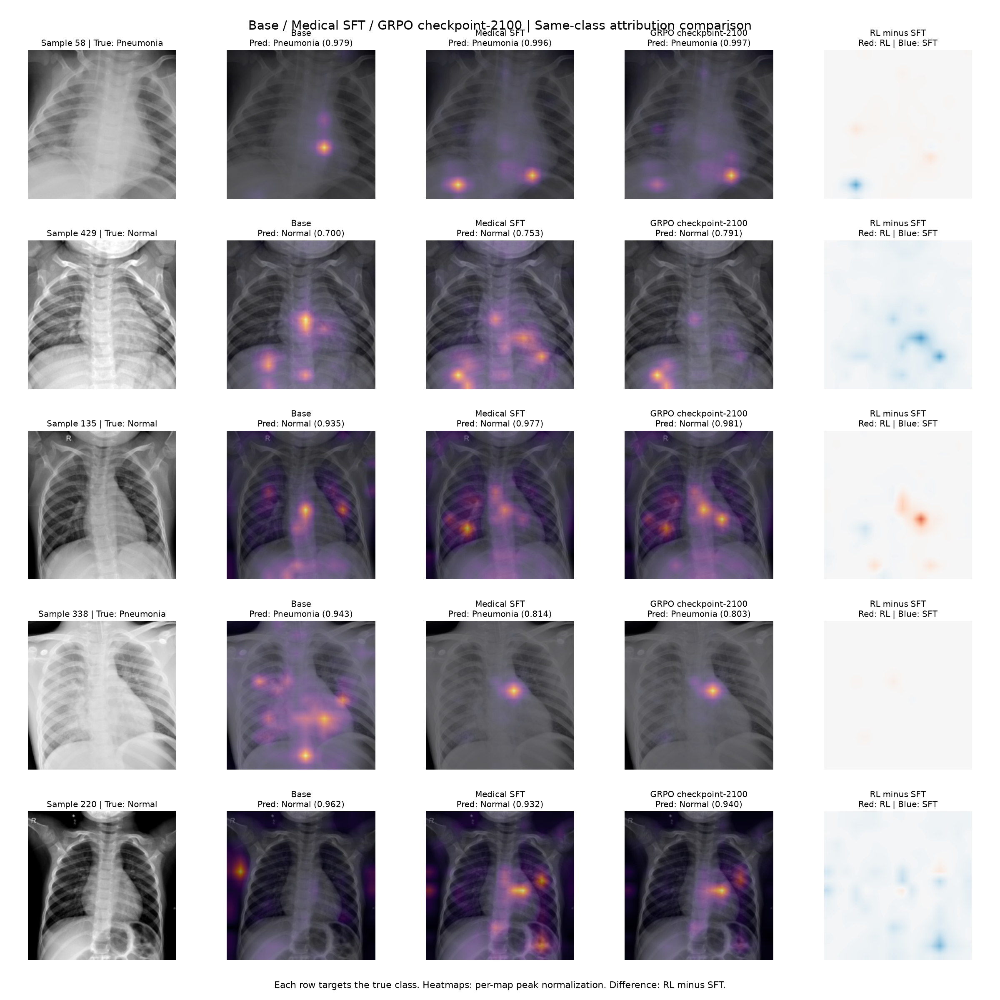

# Base / SFT / RL comparison

25 matched PneumoniaMNIST validation images. Same checkpoint processor, mean vision-token pooling, seed 3407, and 20-epoch frozen-encoder linear-probe training recipe for all three models. RL uses the previously trained classifier; base and SFT probes were freshly trained with matching settings.

Attribution targets the true class on every image for all models. Titles report each model’s predicted class and softmax confidence. Patches are restored to spatial order. Each heatmap is scaled from zero to its own peak; the RL-minus-SFT panel compares relative spatial patterns, not absolute model sensitivity.

| Model | Validation accuracy | Test accuracy | Weighted F1 | AUROC |
|---|---:|---:|---:|---:|
| BASE | 94.66% | 90.38% | 0.9010 | 0.9793 |
| SFT | 95.61% | 89.74% | 0.8939 | 0.9787 |
| RL | 95.42% | 89.74% | 0.8941 | 0.9791 |

Individual five-panel figures are in `maps/`; raw maps for all 75 model/image pairs are in `raw/`. Full per-image metrics are in `attribution_metrics.csv`; settings and metrics are in `summary.json`.

These are classifier attribution maps, not attention weights or explanations of generated answers. Each model has its own trained linear probe, so differences reflect both encoder representation and classifier weights. The 25-image subset was selected before these comparisons and is not the full validation set.
