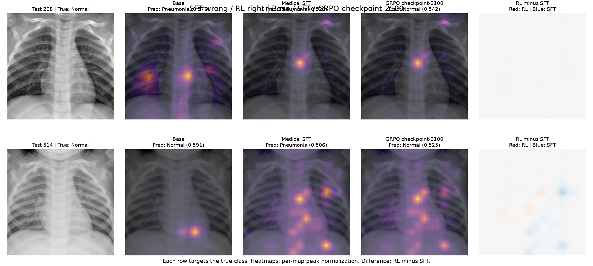

# SFT wrong / RL right: base, SFT, and RL maps

Two PneumoniaMNIST test images selected because SFT was wrong and RL was right. Same processor and true-class attribution target for all models. All classifiers use the matching 20-epoch frozen-encoder recipe from the preceding comparison.

Attribution targets the true class on every image for all models. Titles report each model’s predicted class and softmax confidence. Patches are restored to spatial order. Each heatmap is scaled from zero to its own peak; the RL-minus-SFT panel compares relative spatial patterns, not absolute model sensitivity.

| Model | Validation accuracy | Test accuracy | Weighted F1 | AUROC |
|---|---:|---:|---:|---:|
| BASE | 94.66% | 90.38% | 0.9010 | 0.9793 |
| SFT | 95.61% | 89.74% | 0.8939 | 0.9787 |
| RL | 95.42% | 89.74% | 0.8941 | 0.9791 |

Individual five-panel figures are in `maps/`; raw maps for all 6 model/image pairs are in `raw/`. Full per-image metrics are in `attribution_metrics.csv`; settings and metrics are in `summary.json`.

These are classifier attribution maps, not attention weights or explanations of generated answers. Each model has its own trained linear probe, so differences reflect both encoder representation and classifier weights. These two cases were selected by correctness and are illustrative, not a representative performance estimate.

## Exhaustive search of saved predictions

Validation: 0 SFT-wrong/RL-right cases; 1 SFT-right/RL-wrong case (401).

Test: 2 SFT-wrong/RL-right cases (208, 514); 2 SFT-right/RL-wrong cases (445, 614). Overall test accuracy is tied at 89.74%.

The selected examples are both true Normal images. SFT predicts Pneumonia and RL predicts Normal. Full prediction tables and selected cases are saved in CSV files. Recomputed predictions from the individual image forward passes were checked against the saved test predictions.
